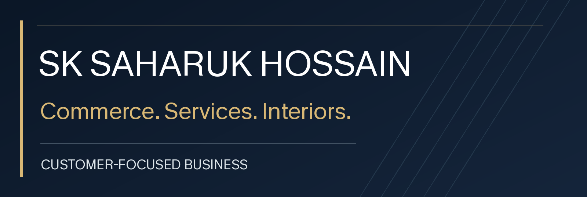

# SK Saharuk Hossain
### Founder, UDECS
E-commerce · Business services · Interiors

Building practical online experiences for customers and small businesses.

[UDECS Store](https://udecs.store) · [UNICK Digital Solutions](https://unick.udecs.store)

---

## About me

I run UDECS, an online retail and B2B wholesale business. My work focuses on product listings, customer experience and day-to-day business operations.

I also work on UNICK Digital Solutions, a separate service brand for business registration, compliance support and online tools.

My SK INTERIOR business focuses on tiles and granite work.

## Business & projects

### 01 · UDECS
Online retail and B2B wholesale across home, kitchen, sports and industrial categories.

[Visit the store →](https://udecs.store)

### 02 · UNICK Digital Solutions
Business services and GST tools for small businesses.

[Explore services →](https://unick.udecs.store)

### 03 · SK INTERIOR
Tiles and granite work for interior projects.

## My focus

- Clear product information and a better shopping experience.
- Simple digital workflows for everyday business tasks.
- Useful online services for small businesses.

---

Business owner first. Technology as a tool to serve customers better.
